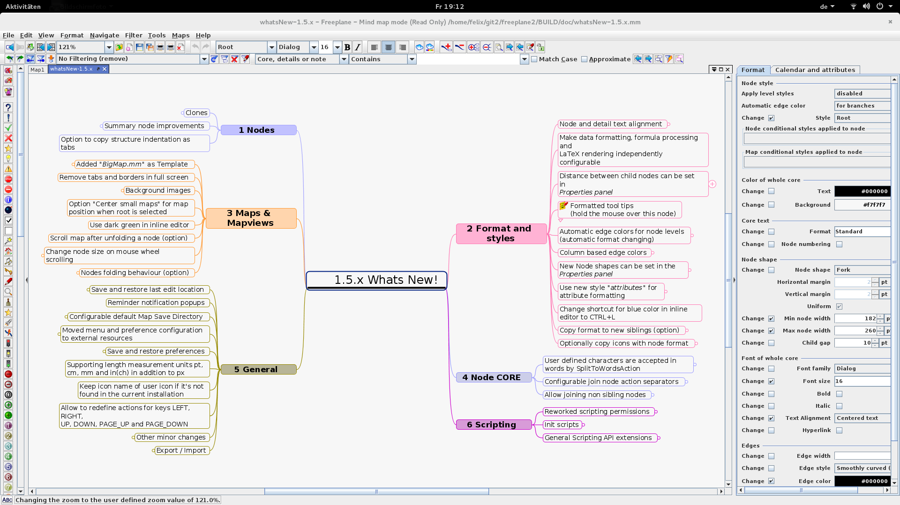
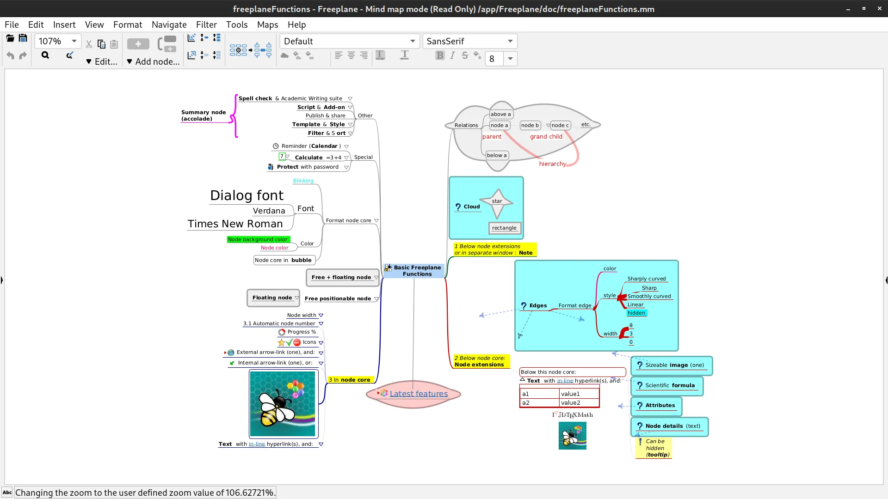

# Freeplane Software for Mind Maps and Knowledge

[](https://github.com/open-source-freeplane/freeplane-software/releases/)

Freeplane software organises ideas, references and project information as connected nodes.
A Freeplane mind map can combine a visual hierarchy with notes, styles and links.
The application runs on the Java platform and supports desktop and portable workflows.

## Features

Use branches to develop an outline and connectors to express additional relationships.
Keep a node's visible title concise while placing longer explanations in its notes.
Folding branches helps focus on one part of a larger map.

| Element | Purpose | Example use |
| --- | --- | --- |
| Parent and child nodes | Express a hierarchy | Divide a project into work areas |
| Notes and details | Add supporting information | Preserve research context |
| Styles | Reuse visual formatting | Distinguish decisions from questions |
| Conditional styles | Apply formatting through rules | Highlight matching node properties |
| Connectors | Show relationships across branches | Link a requirement to a decision |
| Templates | Reuse a map structure | Repeat a meeting or review format |

### Rich Content

Freeplane includes support for Markdown and LaTeX through dedicated components.
Choose the content format according to the material being represented.
Text formatting, formulas and external links serve different roles in a map.



## Styles and Templates

Freeplane mind mapping software supports named styles and conditional formatting.
Apply a consistent style before making many individual visual adjustments.
A reusable template can preserve the structure and presentation of a recurring task.

### Conditional Formatting

A condition determines whether a style applies to a node.
Review the condition and its scope when formatting appears unexpectedly.
Direct formatting and rule-driven formatting should be considered separately.

### Platform Defaults

The supplied macOS defaults are recorded in [freeplane_mac.properties](freeplane_mac/src/main/resources/org/freeplane/plugin/macos/freeplane_mac.properties).
They include menu-icon and look-and-feel preferences.
These defaults are distinct from styles saved inside an individual map.

## Knowledge and Navigation

Freeplane knowledge management combines structured content with navigable relationships.
Use notes for explanations and links for material maintained elsewhere.
Keep enough context in a node to understand why its reference matters.

### Map Maintenance

- Keep branch names specific to their subject.
- Separate a question from the decision that resolves it.
- Fold completed detail when reviewing the larger structure.
- Preserve an editable map alongside exported presentations.

### Files and Exports

The editable mind map and a presentation export have different purposes.
An image captures appearance while a structured export serves another tool.
Review the export options available in the selected release.

## Geographic Context with OpenMaps

The included OpenMaps integration associates a selected location with a node.
Its plugin dependency declaration is in [build.gradle](freeplane_plugin_openmaps/build.gradle).
This is a geographic integration rather than the main mind-map layout engine.

### Location State

[OpenMapsLocation.java](freeplane_plugin_openmaps/src/main/java/org/freeplane/plugin/openmaps/OpenMapsLocation.java) represents stored coordinates.
[OpenMapsNodeHook.java](freeplane_plugin_openmaps/src/main/java/org/freeplane/plugin/openmaps/OpenMapsNodeHook.java) connects location behavior with nodes.

### Map Interaction

[OpenMapsViewer.java](freeplane_plugin_openmaps/src/main/java/org/freeplane/plugin/openmaps/mapelements/OpenMapsViewer.java) configures the geographic viewer.
[OpenMapsController.java](freeplane_plugin_openmaps/src/main/java/org/freeplane/plugin/openmaps/mapelements/OpenMapsController.java) handles interaction with that viewer.

### Location Actions

[InsertOpenMapsAction.java](freeplane_plugin_openmaps/src/main/java/org/freeplane/plugin/openmaps/actions/InsertOpenMapsAction.java) starts location selection.
[ViewOpenMapsAction.java](freeplane_plugin_openmaps/src/main/java/org/freeplane/plugin/openmaps/actions/ViewOpenMapsAction.java) displays the associated location.
[RemoveOpenMapsAction.java](freeplane_plugin_openmaps/src/main/java/org/freeplane/plugin/openmaps/actions/RemoveOpenMapsAction.java) removes the node's location association.

Geographic tiles can require network access.
A node location and a connector between ideas represent different kinds of information.



## Runtime Support Matrix

Choose requirements for the package and task being used.
Some distributions include Java, while others use an independently installed runtime.

| Task or distribution | Relevant requirement | Distinction |
| --- | --- | --- |
| Bundled Windows package | Included Java runtime | Separate Java installation is unnecessary for that package |
| Generic ZIP or Linux package | Compatible Java runtime | Java 21 is within the documented supported range |
| Bundled macOS package | Java 21 and macOS 14 or later | Select the appropriate processor package |
| AI integration in the 1.13 series | Java 17 or later | Additional runtime requirement for that component |
| Source compilation | Java 21 or later and Gradle 9.0 or later | Build tools differ from application runtime needs |

Normal local mind mapping does not require PostgreSQL, MySQL or MariaDB.
An optional integration can introduce its own connection or service requirements.
Check those requirements separately from the desktop application.

## Windows

Windows distributions include packages with Java and packages using a separate runtime.
Portable distribution behavior depends on the launcher and Java package selected.
Match the documentation to the actual package.

[win.dist.gradle](win.dist.gradle) defines Windows distribution tasks.
It concerns packaging rather than the structure of a user's mind map.

## macOS Integration

[MacChanges.java](freeplane_mac/src/main/java/org/freeplane/plugin/macos/MacChanges.java) contains platform-specific desktop integration.
Its imports include desktop handlers for application events and file opening.
Operating-system integration is separate from map content.

[macapp.example.properties](macapp.example.properties) illustrates macOS packaging inputs.
The example contains machine-specific Java paths and signing placeholders.
Those example paths do not define the current application runtime minimum.

## Building the Project

The multi-project layout is declared in [settings.gradle](settings.gradle).
Shared build configuration is maintained in [build.gradle](build.gradle).
The supplied files are a subset; compilation requires the complete source checkout.

The project documents a separately installed Gradle distribution.
It does not commit Gradle wrapper files.
With compatible Java and Gradle available on PATH, use:

```bash
gradle --version
gradle build
gradle dist
```

The commands are examples and have not been executed here.
[dist.gradle](dist.gradle) coordinates distribution-related tasks.
[bin.dist.gradle](bin.dist.gradle) defines the binary ZIP assembly.

### Build and Runtime Versions

A build JDK and the runtime used to launch an existing package are separate choices.
Keep the selected source revision with the dependency versions used to compile it.
Record both when investigating a source-build problem.

## Command-Line Configuration

Freeplane accepts a separate user-configuration directory through its documented -U option.
The following Linux shell example uses a review profile without selecting a map file.

```bash
review_profile="$HOME/.freeplane-review"
freeplane --help
freeplane -U"$review_profile"
```

The final command launches Freeplane with the specified configuration directory.
It is a user-profile choice, not a file-format conversion.
Existing maps can be opened through the normal application controls.

## Groovy Scripts

Freeplane exposes node operations through its scripting API.
This example adds a small review branch beneath the node used as the script context.
Run it in Freeplane's scripting environment rather than a standalone Groovy shell.

```groovy
def review = node.createChild('Review')
review.createChild('Questions')
review.createChild('Next actions')
```

The example changes the open map.
Use a practice map when exploring how a script changes node structure.
Formulas and scripts have different execution contexts.

## Source and Release Context

Open source Freeplane development includes community contributions and reusable extensions.
Use a stable release identifier when reporting a reproducible issue.
Do not infer a release's changes from features documented for an earlier version.

## Related Search Terms

freeplane software, freeplane mind map, open source freeplane, freeplane mind mapping software, freeplane knowledge management, groovy-scripts, java, knowledge-management, latex, markdown, mindmap, mindmap-editor, mind-mapping, diagram, editor
